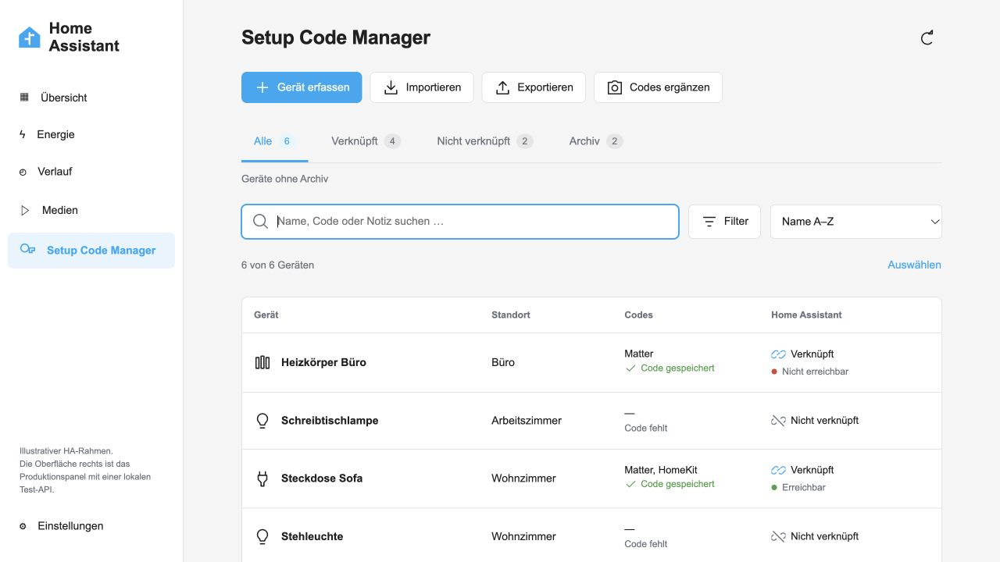

# Setup Code Manager

**Einrichtungscodes griffbereit. Direkt in Home Assistant.**

Verwalte Matter-, HomeKit- und Z-Wave-Codes zusammen mit deinen Geräten.
Scanne einen QR-Code, wähle ein Foto oder gib den Code von Hand ein.
Dein Inventar bleibt lokal in Home Assistant und auch ohne Geräteverknüpfung erhalten.

[Installation](docs/INSTALLATION.de.md) ·
[Vorabversion 0.1.0b13](https://github.com/durkadigital/setup-code-manager/releases/tag/0.1.0b13) ·
[Sicherung](docs/BACKUP.de.md) ·
[English](#english)

[Im Marketplace hinzufügen](https://my.home-assistant.io/redirect/marketplace_repository/?owner=durkadigital&repository=setup-code-manager&category=integration)

*Die Abbildung zeigt die lokale Oberflächenvorschau mit Beispieldaten.*

## Was du damit machen kannst

- **Codes lokal erfassen:** QR-Codes per Livekamera, Fotoaufnahme oder Bildauswahl
  erkennen. Der QR-Decoder wird mitgeliefert; Bilder werden nicht hochgeladen.
- **Matter-Codes wiederfinden:** Zu einem gespeicherten Matter-QR den manuellen
  Einrichtungscode automatisch ableiten, anzeigen und kopieren.
- **Den Überblick behalten:** Nach Gerätenamen, Notizen, QR-Inhalten oder manuellen
  Codes suchen. Raum, Protokoll und Codestatus gemeinsam filtern und Geräte mit
  Home Assistant verknüpfen. **Code gespeichert** zeigt den Codebestand;
  die Erreichbarkeit des Geräts wird separat angezeigt.
- **Listen passend einrichten:** Filter per Button öffnen, nach Raum, Protokoll,
  Codestatus, HA-Etage oder Gerätelabel eingrenzen, sortieren und nach Räumen
  gruppieren. Eigene Ansichten und eine Standardansicht zentral in Home Assistant
  für dein HA-Konto speichern und auf deinen Geräten verwenden. Suchtexte und
  Codeinhalte werden nicht in den Ansichten gespeichert.
- **Gezielt weiterarbeiten:** Markierte Geräte oder aktuelle Treffer als JSON/CSV
  exportieren, Gerätekarten direkt als PDF herunterladen und fehlende Codes
  nacheinander erfassen. PDFs sind für einzelne, gefilterte oder markierte Geräte
  möglich; Notizen bleiben optional.
- **Passende Angaben sehen:** Namen und Räume verknüpfter Geräte aus Home Assistant
  automatisch übernehmen. Eigene Notizen bleiben bearbeitbar; unabhängige Einträge
  können eigene Namen und Standorte haben.
- **Das Inventar behalten:** Geräte ohne HA-Verknüpfung verwalten, archivieren und
  wiederherstellen. Wird ein HA-Gerät entfernt, bleiben Inventareintrag und Codes erhalten.
- **Daten übertragen und sichern:** JSON und CSV einschließlich Archiv exportieren,
  mit Vorschau importieren und Konflikte bewusst entscheiden. Die Inventardatei
  wird mit einer HA-Sicherung des Konfigurationsordners erfasst.

Die [Bedienungsanleitung](docs/USAGE.de.md) erklärt Filter, Ansichten, Auswahlexport,
PDF-Gerätekarten und die geführte Erfassung. Eine [Filteransicht](docs/screenshots/filters.png)
zeigt das neue Dropdown mit Beispieldaten.

Die Oberfläche ist auf Deutsch und Englisch verfügbar. Der Zugriff auf das Panel
und seine Daten ist auf Home-Assistant-Administratoren beschränkt.

## Installation

Setup Code Manager ist eine **benutzerdefinierte Integration** für
**Home Assistant 2026.11 oder neuer**. Installiere sie über den Marketplace oder
kopiere sie manuell in `custom_components`. Aktuell ist **0.1.0b13 eine Vorabversion**;
das Projekt ist noch nicht im allgemeinen Marketplace-Katalog gelistet.

1. **Einstellungen → Marketplace** öffnen und **Add from link** / **Über Link hinzufügen** wählen.
2. `https://github.com/durkadigital/setup-code-manager` hinzufügen und GitHub verbinden,
   wenn Home Assistant dazu auffordert.
3. In den Repository-Details **Vorabversionen** einschließen und **0.1.0b13** auswählen.
4. Installieren und den Einrichtungsdialog abschließen. Bei einem Update den
   angeforderten Home-Assistant-Neustart ausführen.
5. **Setup Code Manager** in der Seitenleiste öffnen.

Lege vor dem Testen eine aktuelle HA-Sicherung an. Manuelle Installation,
Updates und Hinweise für bestehende HACS-Installationen stehen in der
[ausführlichen Anleitung](docs/INSTALLATION.de.md).

## Gut zu wissen

Die Livekamera benötigt **HTTPS und eine Kamerafreigabe**. Fotoauswahl und manuelle
Eingabe stehen als Alternativen zur Verfügung; die Verfügbarkeit der System-Fotoaufnahme
hängt von Browser und Companion-App ab. Gedruckte Ziffern werden nicht per OCR gelesen.

Unterstützt werden Matter-QRs (`MT:`), HomeKit-QRs (`X-HM://`), Z-Wave-SmartStart-QRs
und die jeweiligen manuellen Codes. Pro Gerät wird ein Code je Protokoll gespeichert.
Zusammengesetzte Matter-QRs und bestimmte optionale Matter-Daten werden abgelehnt.
Die Integration verwaltet Codes und koppelt selbst keine Geräte. Matter- und
HomeKit-Codes werden nicht aus Home Assistant ausgelesen.

Codes sind in der Oberfläche zunächst maskiert. **JSON- und CSV-Exporte enthalten
sie im Klartext.** Das Inventar liegt unter `.storage/setup_code_manager` im
HA-Konfigurationsordner; die Integration ergänzt keine eigene Verschlüsselung.
Die Bildverarbeitung erfolgt lokal, Bilder werden nicht gespeichert und es gibt
keinen Cloud-Decoder oder Analysedienst.

PDF-Gerätekarten entstehen direkt in Home Assistant, ohne Popup oder
Browser-Druckdialog. Pro Datei sind 1 bis 100 Geräte möglich. Original-QR und
manueller Matter-Code stehen getrennt darin; Notizen werden nur auf Wunsch
aufgenommen. Die Erzeugung verändert das Inventar nicht und legt auf dem
HA-Server keine PDF-Datei ab. Eine PDF enthält lesbare Codes und ersetzt weder
JSON-/CSV-Export noch HA-Backup. Bei zu großer Ausgabe weniger Geräte wählen oder
Notizen weglassen; die Datei ist auf 8 MiB begrenzt.

## Stand und Hilfe

Die bisherigen Prüfungen umfassen automatisierte Tests, isolierte Läufe mit
echtem HA Core sowie Installation und Neustart von Beta 10 auf HA 2026.11.1.
Zentrale Ansichten wurden in zwei getrennten Browser-Sitzungen geprüft.
Fotoaufnahme in der iPhone-Companion-App wurde bestätigt. PDF-Downloads auf
physischen iPhone- und Android-Geräten, das Sichern per **Teilen → In Dateien
sichern**, Livekamera, Export/Import im Zielsystem und ein vollständiger HA-Restore
stehen noch aus.
Den versionsbezogenen Nachweis und weitere offene Fälle beschreibt der
[Teststand](docs/TESTING.de.md).

Fehler oder Ideen kannst du als [GitHub-Issue](https://github.com/durkadigital/setup-code-manager/issues)
melden. Nenne HA-Version, Integrationsversion und Schritte zum Nachstellen.
Entferne echte Einrichtungscodes und persönliche Daten aus Screenshots und Anhängen.
[Entwicklung und Projektunterlagen](PROJECT.md) enthalten die lokalen Prüfabläufe.

## English

**Keep your device setup codes in Home Assistant.** Setup Code Manager is a custom
integration for Matter, HomeKit and Z-Wave codes, with a German and English interface.
It provides a separate device inventory, local QR scanning from a camera or photo,
manual code entry, search, archive, notes and JSON/CSV import with a preview.
Saved Matter QR codes also provide the derived manual setup code. Search includes
notes, QR payloads and manual codes, with spaces and hyphens ignored for numeric
codes. Combine room, protocol and code-status filters, including missing codes.

Open **Filters** to combine room, protocol, code status, HA floor and direct device
labels. Sort the list, group it by room and save up to 20 views in Home Assistant
for your HA account, available across your browsers and devices. Choose a default
view to load automatically when the panel opens. Search terms and setup codes are
never included in saved views. Select a subset for JSON/CSV export or download
device cards directly as a PDF, and add missing codes through a guided capture
session. PDFs support one record, the filtered list or a selection of up to 100
records. Notes are opt-in. Original QR and manual Matter code remain separate.
Home Assistant generates the file locally without a popup, browser print dialog,
server-side file storage or inventory changes. The output limit is 8 MiB;
choose fewer records or omit notes if it is exceeded.

Link an entry to Home Assistant to keep its device name and area up to date.
These fields are read-only while linked; notes remain editable. Removing an HA
device keeps the inventory entry and its codes. Panel and API access require an
administrator account.

**Install the current pre-release, 0.1.0b13:** In **HA 2026.11+**, open **Settings →
Marketplace → Add from link**, add
`https://github.com/durkadigital/setup-code-manager`, connect GitHub when prompted,
enable **Pre-releases** in the repository details and select **0.1.0b13**. Install
and complete setup; restart HA when requested after an update. The project is
currently available as a custom repository and is not listed in the general catalog.

For manual installation, download the
[release source ZIP](https://github.com/durkadigital/setup-code-manager/releases/tag/0.1.0b13),
copy `custom_components/setup_code_manager` to the same path in your HA configuration,
restart and add the integration under **Settings → Devices & services**.
Back up HA before testing.

**Privacy and limits:** Decoding runs locally, and images are neither uploaded
nor stored. Live video needs HTTPS and camera permission. There is no OCR, and
each device can hold one code per protocol. The integration does not pair devices.
Exports contain setup codes in plain text, and the inventory has no additional
encryption beyond your HA environment. Include the configuration folder in HA
backups; an inventory export does not replace a full HA backup. PDFs are readable
copies of selected codes and cannot be imported as an inventory backup.

This is beta software. Automated tests, isolated HA runtime tests and real PDF
downloads in desktop/mobile browser layouts have passed; beta 10 installation,
restart and account views in two independent browser sessions have been checked.
Physical iPhone/Android PDF download and iPhone Share to Files,
live scanning, export/import on the target system and a full HA restore
still need practical verification. See the [test record](docs/TESTING.de.md) and
[report issues](https://github.com/durkadigital/setup-code-manager/issues) without
including real setup codes or private data.

## Lizenz und Herkunft / License and credits

Dieses Projekt basiert auf [PhantomPhoton/Setup-Codes](https://github.com/PhantomPhoton/Setup-Codes).
Originalhistorie, Urheberhinweise und die [MIT-Lizenz](LICENSE) bleiben erhalten.
Der lokale QR-Decoder [jsQR](custom_components/setup_code_manager/www/vendor/README.md)
steht unter Apache-2.0; seine Lizenz wird mitgeliefert. PDF-Erzeugung verwendet
[ReportLab 5.1.0](custom_components/setup_code_manager/licenses/REPORTLAB.txt) und
[Bitstream-Vera-Schriften](custom_components/setup_code_manager/licenses/BITSTREAM_VERA.txt)
mit ihren unveränderten Lizenzhinweisen. Weitere Angaben stehen in
der [Herkunftsdokumentation](docs/PROVENANCE.md).
